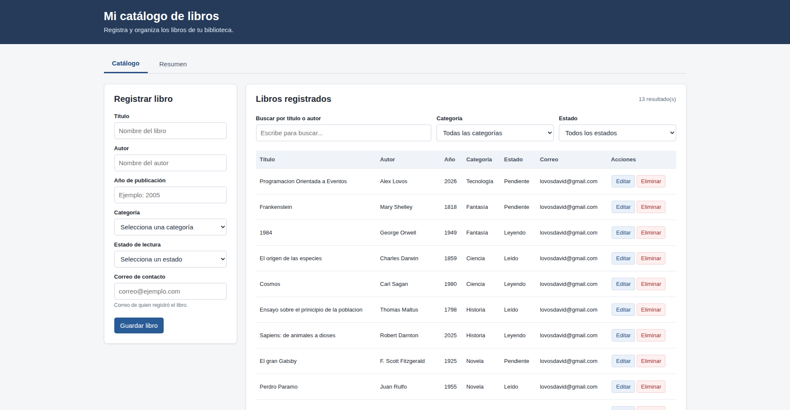
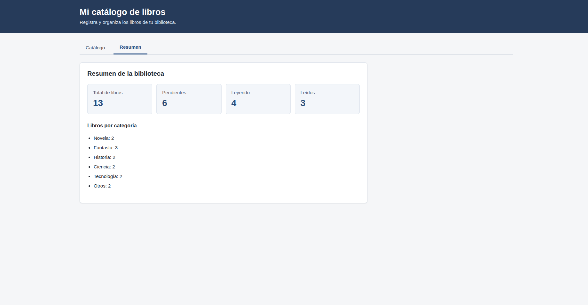

Mi catálogo de libros - Parcial 2

Proyecto de registro de libros desarrollado con TypeScript y arquitectura MVC. Es una continuación del Laboratorio 2. Sirve para guardar información de los libros, no para leer o escribir sus páginas.

Tecnologías

-HTML y CSS para la interfaz.
-TypeScript para las funciones.
-localStorage del navegador para guardar los registros.

Funciones

-Registrar libros con título, autor, año, categoría, estado de lectura y correo de contacto.
-Ver, editar y eliminar libros.
-Buscar por título o autor mientras se escribe.
-Filtrar por categoría y estado al mismo tiempo que se busca.
-Comprobar campos, correo, año de publicación y libros repetidos.
-Guardar los cambios en el navegador para conservarlos al recargar.
-Mostrar avisos de éxito o error que desaparecen automáticamente.
-Cambiar entre las pestañas catálogo y resumen, con contadores.

Cómo ejecutarlo

Se necesita tener Node.js, npm y un navegador instalado.

1. Abrir una terminal en la carpeta del proyecto.
2. Ejecutar `npm install` (solo la primera vez).
3. Ejecutar `npm run build` para compilar TypeScript.
4. Iniciar un servidor local. En Ubuntu se puede usar `python3 -m http.server 5500`.
5. Abrir `http://localhost:5500` en el navegador.

Estructura MVC del proyecto

catalogo-libros-parcial2/
├── index.html
├── styles.css
├── src/
│   ├── app.ts
│   ├── models/
│   │   ├── Libro.ts
│   │   └── LibroModel.ts
│   ├── views/
│   │   └── LibroView.ts
│   ├── controllers/
│   │   └── LibroController.ts
│   └── services/
│       └── StorageService.ts
├── dist/                  (código compilado)
├── capturas/
├── package.json
├── tsconfig.json
└── README.md

- Modelo: guarda la lista de libros y contiene las validaciones.
- Vista: presenta el formulario, la tabla, los mensajes y los contadores.
- Controlador: recibe los eventos del usuario y comunica modelo y vista.
- StorageService: carga y guarda el catálogo mediante localStorage.

Capturas de pantalla

Vista del catálogo con libros de ejemplo**

Vista de resumen

